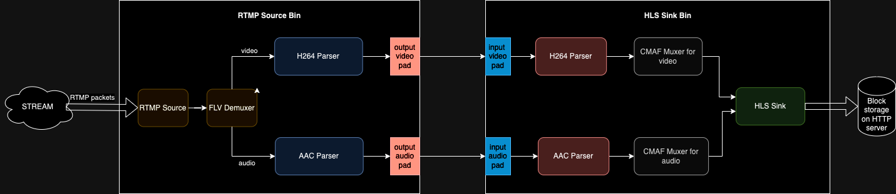

Neon is a live-streaming platform for software engineering and IT streamers, built as a third-year project at INSAT with [Zeineb BenAbdallah](https://github.com/zei-ZZ) and [Mohamed Hedi Ben Ali](https://github.com/medhedibenali). The goal was a scalable and reliable streaming platform, and the interesting part is the architecture: a streamer pushes video over RTMP, the backend repackages it into HLS that any browser can play, and viewers chat in real time next to the stream.

The code is on [GitHub](https://github.com/RaedAddala/Neon), and the design is documented in the [technical report](https://github.com/RaedAddala/Neon/blob/master/Project%20Report.pdf) (PDF).

## Architecture

The backend is split into three Elixir/Phoenix services, each in its own container, behind a Kong API gateway:

| Component | Responsibility | Main technology |
|---|---|---|
| **Auth service** | Registration, login, profiles, follows, and JWT issuance | Phoenix 1.7, Ecto + PostgreSQL, Guardian, Argon2 |
| **Live chat service** | Real-time chat rooms per streamer | Phoenix Channels over WebSocket |
| **Live streaming service** | RTMP ingest, repackaging to HLS, and serving the segments | Membrane 1.0, Phoenix |
| **API gateway** | Single entry point, routing, and token verification | Kong (DB-less), custom Lua plugin |
| **Frontend** | Sign-up, login, profiles, and the watch page with chat | SvelteKit 2, Svelte 4, Tailwind CSS |

The services share no database and do not call each other: only the auth service has a database (PostgreSQL), and the other services get the caller's identity from the gateway instead of asking the auth service. This keeps the three workloads separate. Authentication is CPU-light request/response traffic, chat is many long-lived WebSocket connections, and media processing is CPU- and I/O-heavy, so each can be scaled or restarted on its own.

## Gateway and authentication

Kong runs **DB-less**: all services, routes, and plugins are defined in one declarative `kong.yaml`. Public routes (register, login, reading profiles, uploaded images, and the stream) pass straight through, while profile changes and logout require a valid token.

Tokens are **RS256 JWTs** signed by the auth service with Guardian. Asymmetric signing is what lets verification move out of the services: the gateway only needs the public key, never the signing key. The auth service generates an RSA key pair and rotates it on a timer from a supervised GenServer, and a small cron container fetches the current public key from the auth service every hour and writes it to a volume that Kong reads.

Verification is done by a **custom Kong plugin written in Lua**. The report explains why Kong's built-in JWT plugin was not enough: it does not work with WebSockets, and browsers cannot attach an `Authorization` header to a WebSocket handshake. The plugin has two modes:

- **Header mode** for HTTP routes reads a `Bearer` token and forwards the caller's identity to the service as headers.
- **Query mode** for the chat socket reads the token from the connection URL and forwards the identity as query parameters. It also allows anonymous connections, so anyone can read a chat while only signed-in users can write.

## Streaming pipeline

The streaming service runs an **RTMP server** on TCP port 9006. A streamer points an encoder such as OBS at it, and each incoming connection starts its **own Membrane pipeline**, a separate Erlang process, so one broken stream cannot take down another.

Inside the pipeline, Membrane's RTMP source demuxes the FLV stream into its audio and video tracks and parses them as **AAC** and **H.264**. The HTTP adaptive stream sink then packages each track as CMAF (fragmented MP4) in **4-second segments** and writes an HLS playlist. Phoenix serves the playlist and segments over plain HTTP, and the browser plays them with hls.js.

The split follows the first-mile / last-mile difference: **RTMP** is a good fit for ingest from a single encoder over a persistent TCP connection, while **HLS** is plain HTTP files, which every browser and CDN can handle.

## Live chat

Each streamer has a chat room, a Phoenix Channels topic named after them (`chat:<username>`). Anyone can join and read, but only sockets that carry an identity verified by the gateway can send messages, and the server, not the client, attaches the sender's name and a timestamp before broadcasting. Messages are relayed live and not stored.

## Frontend

The SvelteKit app has routes for sign-up, login, profile management, starting a stream, and watching a streamer (`/watch/[username]`). Forms use server-side actions with sveltekit-superforms and zod validation that call the gateway. The chat uses the Phoenix JavaScript client over the gateway's WebSocket route, and the UI is built with Tailwind CSS and shadcn-svelte components.

## Deployment

The whole backend runs with **Docker Compose**: the three services, PostgreSQL, Kong, and the key-fetching cron container. Volumes hold the database, uploaded profile pictures, and the shared public key. Kong is the public HTTP entry point (port 8000), with its admin ports bound to localhost. The streaming service also exposes its RTMP port for encoders and its HTTP port for video playback.

## Tech stack

- **Backend:** Elixir 1.16 on OTP 26, Phoenix 1.7 (auth and chat) and 1.6 (streaming), Ecto, PostgreSQL
- **Media:** Membrane Core 1.0, Membrane RTMP plugin, Membrane HTTP Adaptive Stream plugin (HLS, CMAF)
- **Security:** Guardian (RS256 JWTs), Argon2 password hashing, Kong with a custom Lua plugin
- **Frontend:** SvelteKit 2, Svelte 4, Vite 5, Tailwind CSS, shadcn-svelte, sveltekit-superforms, zod, Phoenix JS client
- **Infrastructure:** Docker, Docker Compose, Kong (DB-less mode)

## Scope and next steps

Neon is a working prototype of the architecture rather than a production service. It handles one live stream at a time (all pipelines write to the same output folder, with no stream keys yet), serves a single rendition without a bitrate ladder, and keeps chat in memory only.

The report's next steps are storage, notification, and subscription services, a recommender, **Kafka with object storage (S3) for video chunks**, H.265 and more renditions, a job scheduler with worker clusters for transcoding, and Snowflake IDs instead of UUIDs.
